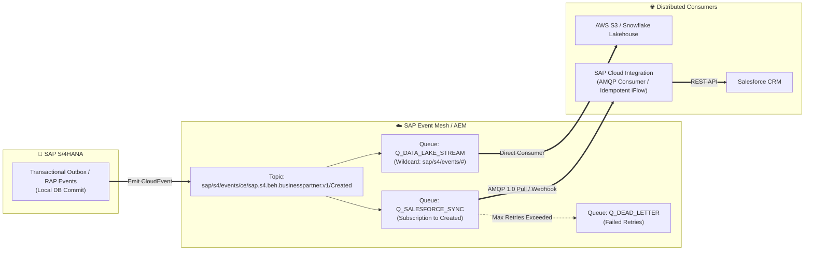

# ⚡ SAP Event Mesh & EDA: Enterprise Event-Driven Architecture Showcase

[](https://community.sap.com/topics/event-mesh)
[](https://cloudevents.io/)
[](https://www.amqp.org/)
[](LICENSE)

An architectural reference showcase demonstrating **Event-Driven Architecture (EDA)** using **SAP Event Mesh** in the **SAP BTP Integration Suite**.

Decouple mission-critical enterprise systems (SAP S/4HANA, Salesforce, Third-Party Microservices) through asynchronous, guaranteed-delivery event pipelines.

---

## 📑 Table of Contents

1. [Why Event-Driven Architecture for SAP?](#-why-event-driven-architecture-for-sap)
2. [Architecture Blueprint](#-architecture-blueprint)
3. [CloudEvents Standard Payloads](#-cloudevents-standard-payloads)
4. [Repository Structure](#-repository-structure)
5. [Idempotency & Dead Letter Queue (DLQ)](#-idempotency--dead-letter-queue-dlq)
6. [Enterprise Queuing & Webhook Guide](docs/Event_Mesh_Enterprise_Queuing_Architecture.md)

---

## 💡 Why Event-Driven Architecture for SAP?

Traditional point-to-point batch and polling interfaces (like legacy PI/PO File polling or scheduled IDoc batch runs) suffer from:
* **High latency:** Data is only synchronized when polling cycles trigger.
* **Tight coupling:** If a target system is down, the sender fails or exhausts memory buffers.
* **Excessive backend load:** Continuous DB polling queries waste SAP CPU cycles.

**Event Mesh solves this by adopting Publish/Subscribe (Pub/Sub):**
* SAP S/4HANA publishes a lightweight notification event when business entities change (e.g. `BusinessPartner.Created`).
* Interested consumers subscribe to the topic queue asynchronously.
* SAP BTP handles guaranteed store-and-forward delivery.

---

## 🏛️ Architecture Blueprint



---

## 📜 CloudEvents Standard Payloads

All events adhere strictly to the CNCF **CloudEvents 1.0.2** specification:

* **[`cloudevents/business-partner-created.json`](cloudevents/business-partner-created.json)**: Real-world S/4HANA Business Partner Creation event containing trace context and entity keys.
* **[`cloudevents/sales-order-blocked.json`](cloudevents/sales-order-blocked.json)**: Credit limit breach / blocked order event triggering fraud and escalation workflows.

---

## 📂 Repository Structure

```
├── README.md
├── cloudevents/
│   ├── business-partner-created.json      # Sample CNCF CloudEvent payload
│   └── sales-order-blocked.json           # Sample blocked sales order event
├── simulator/
│   ├── event_publisher.py                 # Python producer simulating S/4HANA events
│   ├── event_subscriber.py                # Python consumer simulating receiver queue
│   └── requirements.txt                   # Dependency file (requests, pika, stomp)
└── docs/
    ├── Topic_Hierarchy_Design_Guide.md    # Multi-tenant topic naming standards
    └── Event_Mesh_Enterprise_Queuing_Architecture.md # Queues, webhooks & DLQ governance
```

---

## 🛡️ Idempotency & Dead Letter Queue (DLQ)

Because network disruptions can lead to event redelivery, all consumers must be **idempotent**:
1. **Deduplication Check**: Store `id` (`data.idocNumber` or CloudEvent `id`) in a fast BTP Data Store or Redis cache with a TTL of 7 days.
2. **Atomic Lock**: If the event ID was already processed, acknowledge the queue (`ACK`) immediately and discard the duplicate.
3. **Dead Letter Queue (DLQ)**: If a target consumer fails after 5 retries, move the message to `Q_DEAD_LETTER` with an audit header detailing the error.
