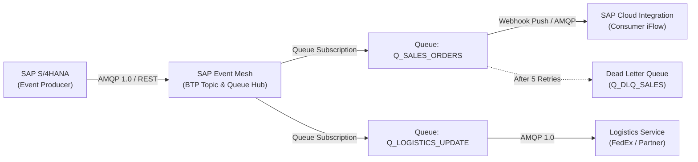

# ⚡ SAP Event Mesh: Enterprise Queuing & Webhook Architecture

A comprehensive technical guide to designing, deploying, and managing event-driven integrations using **SAP Event Mesh** on SAP BTP.

---

## 1. Architectural Overview

**SAP Event Mesh** is a fully managed cloud service on SAP BTP that provides asynchronous event distribution across SAP systems (S/4HANA, ECC, SAP Ariba) and non-SAP cloud/on-premise applications.

---

## 2. Core Concepts & Configuration Model

### 2.1 Topics vs. Queues
* **Topics:** Publish-only routing destinations. Producers publish messages to hierarchical topics (e.g. `sap/s4hana/sales/order/created`) without knowing who consumes them.
* **Queues:** Storage endpoints that persist messages until consumed. Queues bind to one or more topic subscriptions to capture relevant events.
* **Topic Subscriptions:** Rules defined on queues to ingest events matching specific topic filters using standard wildcards (`*` for single-level, `>` or `#` for multi-level).

### 2.2 Supported Protocols
* **AMQP 1.0:** High-performance, binary, bidirectional protocol ideal for integration runtimes (CPI, Node.js, Spring Boot).
* **MQTT 3.1.1:** Lightweight publish/subscribe protocol suited for constrained network clients and edge scenarios.
* **REST APIs:** HTTP POST endpoints to publish events or receive webhook push deliveries.

---

## 3. Webhook Subscriptions (Push-Based Consumption)

Instead of consumers continuously polling queues, SAP Event Mesh supports **Webhook Subscriptions**:
* **Push Delivery:** Event Mesh actively initiates an HTTP POST request to a configured endpoint (e.g., a CPI HTTPS sender endpoint) whenever a message enters the queue.
* **Authentication:** Secured via OAuth 2.0 Client Credentials or Client Certificates (mTLS).
* **Backpressure & Retries:** Automatic exponential backoff when downstream receivers return HTTP 429 (Too Many Requests) or 5xx server errors.

---

## 4. Reliability & Dead Letter Queue (DLQ) Governance

* **Guaranteed Delivery (QoS 1):** Messages are safely persisted in BTP storage until acknowledged (`ACK`) by the consumer.
* **Max Retry Threshold:** If a consumer returns consecutive errors or fails to acknowledge, Event Mesh retries up to the configured limit (e.g., 5 attempts).
* **Dead Letter Routing:** Unprocessable messages (poison pills) automatically divert to a designated Dead Letter Queue (`Q_DLQ_*`) with error headers preserved, preventing poison pill blocking of the main queue.
